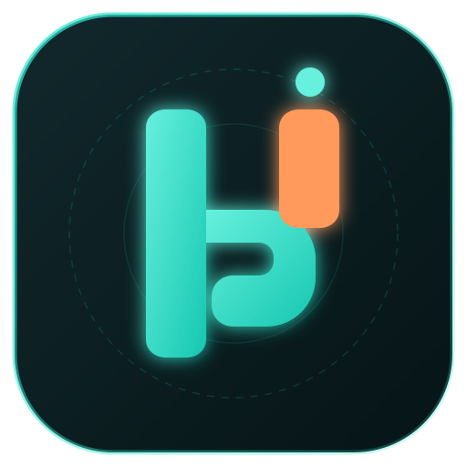

<div align="center">
  
  <h1>Hookpost</h1>
  <p><strong>The All-in-One Social Media Scheduler & Multi-Agent AI Copilot</strong></p>
  <p><em>Schedule to X, LinkedIn, YouTube, Bluesky, Discord, Telegram and more from one calendar &mdash; or straight from Claude, Cursor and Windsurf.</em></p>

  <p>
    <a href="https://hookpost.hookstep.in"></a>
    <a href="./LICENSE"></a>
    <a href="https://hub.docker.com"></a>
    <a href="https://nextjs.org"></a>
  </p>

  <p>
    <a href="https://hookpost.hookstep.in/auth"><strong>Get Started (Cloud) »</strong></a> •
    <a href="#self-hosting"><strong>Self-hosting »</strong></a> •
    <a href="https://hookpost.hookstep.in/docs/public-api"><strong>Documentation »</strong></a>
  </p>
</div>

---

## ⚡ What is Hookpost?

**Hookpost** is a social media scheduler: write a post once, schedule it on one visual calendar, and it publishes to every network at the time you pick. It is also built for AI agents, with an MCP server so Claude, Cursor and other MCP clients can list your channels and schedule posts for you.

A flat-priced alternative to **Buffer**, **Hootsuite** and **Later**. Use the hosted version at [hookpost.hookstep.in](https://hookpost.hookstep.in) or run it yourself.

### 🌐 Networks that publish today

X (Twitter) · LinkedIn (personal profiles) · YouTube (videos and Shorts) · Facebook Pages · Bluesky · Discord · Slack · Telegram · WordPress · Hashnode · Dev.to · Lemmy · Nostr · Listmonk (email)

Instagram and Threads are built and waiting on Meta app approval for the cloud version. Pinterest connects but cannot publish until Pinterest grants Standard API access. Medium no longer issues new API tokens, so Add Channel does not offer it; a Medium channel connected earlier keeps working.

### 🌟 Features

* 🤖 **MCP server for AI agents**: connect Claude Desktop, Claude Code, Cursor or Windsurf and let the assistant draft and schedule posts. [Setup guide](https://hookpost.hookstep.in/guides/claude-mcp-social-media)
  A standalone stdio server that wraps the public API lives in [`mcp-server/`](./mcp-server) (list channels, upload media, create, list and delete posts).
* 📅 **Visual calendar**: drag-and-drop planning, per-network previews, and character limits checked before a post is queued.
* ✍️ **AI writing and images** inside the composer.
* 🔌 **REST API, webhooks, CLI (`npx hookpost`) and an n8n node** ([`n8n-nodes-hookpost`](https://www.npmjs.com/package/n8n-nodes-hookpost)).
* 💳 **Flat pricing in rupees** on the cloud version: one price per plan instead of a fee per channel, starting with 3 free posts and no card, with UPI Autopay via Razorpay.
* 🔓 **Open source (AGPL-3.0)** by Hookstep: self-host it, or use the hosted version at [hookpost.hookstep.in](https://hookpost.hookstep.in). See [License](#license).

### 🔎 Compare

* [Hookpost vs Buffer](https://hookpost.hookstep.in/alternatives/buffer) · [vs Postiz](https://hookpost.hookstep.in/alternatives/postiz) · [vs Hootsuite](https://hookpost.hookstep.in/alternatives/hootsuite) · [vs Later](https://hookpost.hookstep.in/alternatives/later)
* [Social media character counter](https://hookpost.hookstep.in/tools/character-counter) (free tool)

---

## Open source

Hookpost is open source under the GNU Affero General Public License v3.0. You can read the code, run it on your own server, change it and share your changes. If you run a modified Hookpost as a service for other people, the AGPL asks you to offer those users the source of your modified version.

The hosted version at [hookpost.hookstep.in](https://hookpost.hookstep.in) runs this same code with billing turned on. Self-hosted installs have no paywall: billing switches off when no payment keys are set.

## Self-hosting

```bash
git clone https://github.com/hookstep/hookpost.git
cd hookpost
cp .env.example .env            # fill in the values marked "required"
docker compose -f docker-compose.dev.yaml up -d   # Postgres, Redis, Temporal
pnpm install
pnpm run dev                    # backend, frontend, orchestrator and extension in watch mode
```

Social networks need their own developer apps (X, LinkedIn, YouTube and so on). The variable names for each provider are in `.env.example`.

---

## ☁️ Hookpost Cloud (Managed SaaS)

Don't want to run servers? The hosted version has no Docker, Redis, PostgreSQL or OAuth app verification for you to manage.

👉 **[Try Hookpost Cloud: 3 free posts, no card needed](https://hookpost.hookstep.in/auth)**

* 3 free posts, no card needed. Then first month 20% off (new customers), and ₹599 a month for Standard after that. There is no time-limited trial.
* Flat monthly plans in rupees, no per-channel fee.
* Payments through Razorpay: UPI Autopay, cards, NetBanking.

---

## 🛠️ Architecture & Tech Stack

* **Frontend**: Next.js 16 (App Router), React 19, Tailwind CSS, TurboPack
* **Backend**: NestJS, TypeScript, Prisma ORM
* **Database**: PostgreSQL
* **Cache / Queue**: Redis (Upstash / Local Redis BullMQ)
* **Workflows**: Temporal
* **AI**: Model Context Protocol (MCP) server, OpenAI SDK

---

## 🎨 Brand colours: one switch

The whole colour scheme (app, marketing site, emails, favicons, OG image, PWA manifest, browser extension) comes from one registry, [`libraries/helpers/src/brand/brand-themes.ts`](libraries/helpers/src/brand/brand-themes.ts), which holds three themes: `tidewire` (live), `marigold` and `coral`, each with a dark and a light set.

To switch themes:

1. Set `NEXT_PUBLIC_BRAND_THEME=marigold` (or change `DEFAULT_BRAND_THEME` in that file, which is the permanent switch).
2. Run `pnpm brand:assets` to redraw the favicons, logo, OG image and manifest colours.
3. Build as usual. `brand-themes.spec.ts` fails if step 2 was skipped.

How it works: every root layout puts `data-brand-theme` on `<html>` and renders the theme's `--hp-*` CSS variables (bg, surface, elevated, border, text-2/3, primary + hover/active, on-primary, primary-text, accent, focus, success/warning/danger, chart-1..5). Tailwind maps them as `hp-*` colours (`bg-hp-primary`, `text-hp-primary-text`, `border-hp-border`, `bg-hp-primary/10`), and the older `--new-*` / `--color-*` variables in `colors.scss` point at them. Canvas charts, Razorpay checkout and emails read the same values through `brandTokens()`.

Never hardcode a brand colour: `brand-colours.guard.spec.ts` fails on the retired colours, on any purple or magenta hex, and on Tailwind's purple/violet/indigo/fuchsia/pink classes outside the registry.

---

## Contributing

Issues labelled [`good first issue`](../../issues?q=is%3Aopen+label%3A%22good+first+issue%22) are a good place to start. Read [CONTRIBUTING.md](./CONTRIBUTING.md) before opening a pull request, and [SECURITY.md](./SECURITY.md) if you found a vulnerability (please do not open a public issue for those).

---

## License

Hookpost is licensed under the [GNU AGPL v3.0](./LICENSE). It contains code from Postiz (https://github.com/gitroomhq/postiz-app), copyright Gitroom and the Postiz contributors, also under the AGPL v3.0. See [NOTICE](./NOTICE) for details.

The Hookpost name and logo are not covered by the AGPL. You may fork and rebrand the code, but please do not publish a fork under the Hookpost name or logo.

---

<div align="center">
  <p>Built with ❤️ by Hookstep • <a href="https://hookpost.hookstep.in">hookpost.hookstep.in</a></p>
</div>

## Contributors

Thanks to everyone who has contributed. New here? Start with an issue labelled `good first issue`.

<a href="https://github.com/hookstep/hookpost/graphs/contributors"></a>
